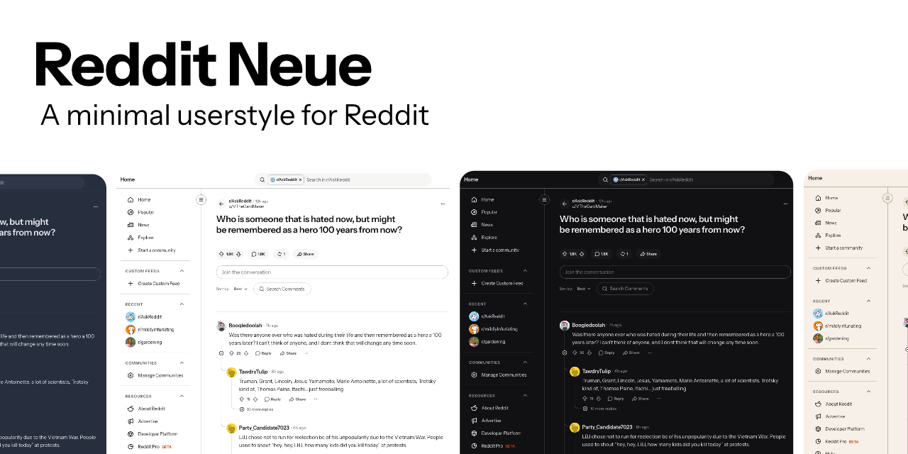
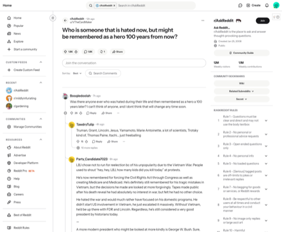
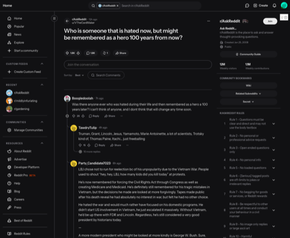
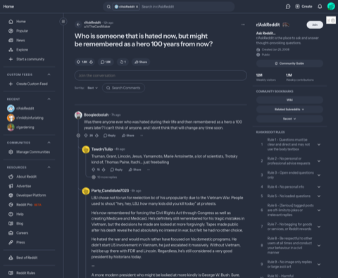
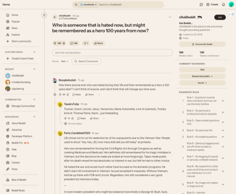
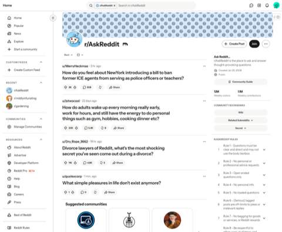
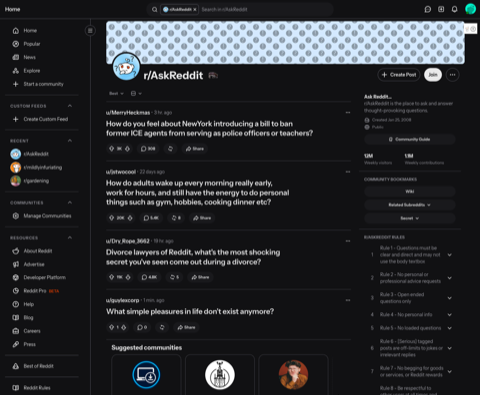
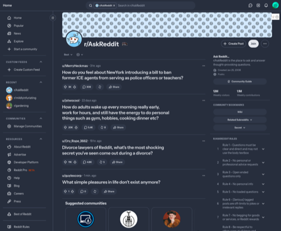
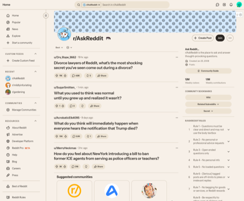

A minimal, typography-first restyle of [Reddit](https://www.reddit.com), made for reading threads. Airy and discreet. Light, dark, slate or paper, or follows your system.

- **Desktop style.** Installs with the free [Stylus](https://add0n.com/stylus.html) browser extension.
- **Quiet.** One typeface, hairline dividers, no logo, lots of room around text. Ads and clutter (promoted posts, award buttons, the Games menu) are hidden.
- **Easy to follow.** Clear lines between replies, and comments from the original poster and from moderators get a soft highlight.
- **Customisable.** Light, dark, slate (blue-grey), paper (warm beige) or follow your system. Fonts, text size, line spacing and accent colour.

Works on new Reddit (`www.reddit.com`) in desktop browsers.

<table>
  <tr>
    <td width="25%"></td>
    <td width="25%"></td>
    <td width="25%"></td>
    <td width="25%"></td>
  </tr>
  <tr>
    <td width="25%"></td>
    <td width="25%"></td>
    <td width="25%"></td>
    <td width="25%"></td>
  </tr>
</table>

Light, dark, slate and paper. A thread on top, a community page below. Click an image for the full size.

## Install

1. Install [Stylus](https://chromewebstore.google.com/detail/stylus/clngdbkpkpeebahjckkjfobafhncgmne) (for Chrome, Brave, Edge and Firefox)
2. [Open this link](https://raw.githubusercontent.com/wordsandpics/reddit-neue/main/reddit-neue.user.css). Stylus offers to install the style.
3. Click **Install**, then reload Reddit.

The style is also listed on [userstyles.world](https://userstyles.world/style/31412/reddit-neue).

Tested in Chrome and Firefox. Stylus checks for new versions on its own. Other style extensions are untested and may not read the file or its settings.

**Settings:** click the Stylus icon, then the gear next to Reddit Neue. You can change the colour theme (follow system, light, dark, slate or paper), the interface font, the post and comment font, text size, line height and accent colour.

**Fonts:** the style loads Instrument Sans from Google Fonts, so your browser contacts Google when a Reddit page loads. The font is open-licensed. To use another font, type its name into the font settings (any font installed on your computer works). A web font also needs its own `@import` line at the top of the file.

## Known gaps

- Feeds, posts, comments, the header and both sidebars are fully styled. Other pages (search, inbox and the like) get a lighter treatment.
- A few small parts, such as the vote buttons and menus, keep Reddit's own shapes and only follow the colours.
- Desktop only. The mobile site, the app and old.reddit.com are not covered.
- Reddit changes its pages often. When it does, something may look off until the style catches up.

Found something that looks wrong? Open an [issue](https://github.com/wordsandpics/reddit-neue/issues) with a screenshot and the page address.

## Licence

[MIT](LICENSE). Copyright (c) 2026 wordsandpics. Not affiliated with Reddit.
